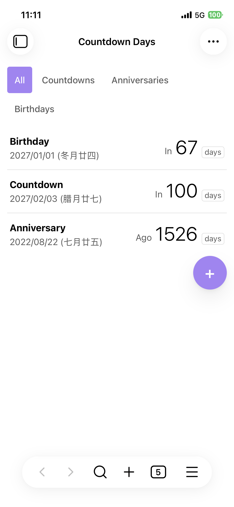
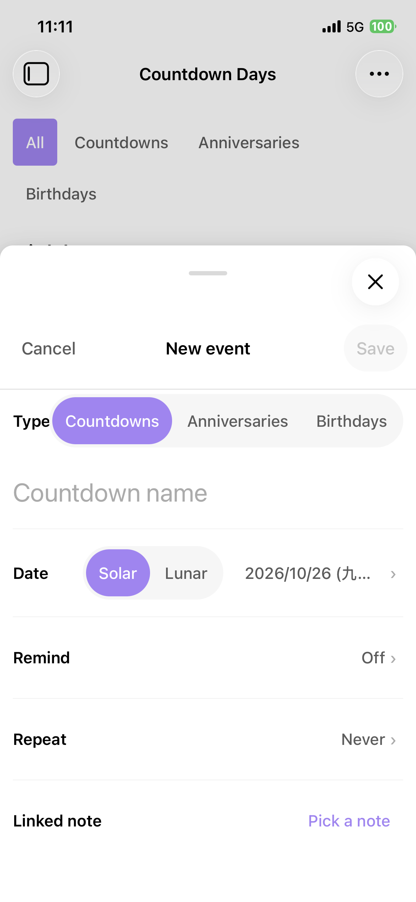

# Countdown Day

[中文说明](README.zh.md)

An [Obsidian](https://obsidian.md) plugin for tracking countdowns and memorial days — birthdays, anniversaries — with full **solar & lunar calendar** support (leap months included).

<p align="center">
  
  
</p>

## Features

- **List view** — one row per event (name, date with lunar label, big day count), soonest first; pinned on top, expired sink to the bottom; type filters (all / countdowns / anniversaries / birthdays). Text actions on desktop, left-swipe on touch devices.
- **Sheet-style dialogs** — bottom sheets on mobile, centered on desktop; month-grid date picker on desktop, iOS-style wheel on mobile; solar/lunar picks convert automatically, so an invalid date can never be entered.
- **Repeat** — never / daily / weekdays / weekly / monthly / yearly, or custom every-N-days. Yearly lunar events fall back automatically in years without that leap month or a 30th day.
- **Events are notes** — one markdown file per event (default folder `Countdowns/`), frontmatter is the data. Edit by hand or via the form — the view updates live.
- **Embed anywhere** — render event rows in any note with a `countdown` code block.
- **Reminders** — multi-select days ahead; desktop system notifications (Obsidian notices as fallback / on mobile), once per occurrence and day.
- **Bilingual UI** (English / 简体中文), follows your Obsidian language.

## Usage

### Creating events

Open the view via the ribbon icon (calendar-clock) or the command palette (_"Countdown Day: Countdown Days"_), tap **+**, fill the form, save.

### Embedding in a note

````markdown
```countdown
type: birthday, anniversary
limit: 5
```
````

| Option  | Format                | Default   | Description           |
| ------- | --------------------- | --------- | --------------------- |
| `type`  | comma-separated types | all       | filter by event type  |
| `limit` | positive integer      | unlimited | show only the first N |

### Reminders

Pick one or more **remind** days on an event. A notification fires when today is exactly one of those days ahead of an occurrence — checked at startup, every 10 minutes, and when events change; once per occurrence and day.

### Settings

- **Events folder** — where event files live (default `Countdowns/`); created automatically on first event.

### Event file format

File name = event name; body = your notes. Frontmatter fields (unknown fields are always preserved):

| Field          | Values                                                                     | Default  | Description                                              |
| -------------- | -------------------------------------------------------------------------- | -------- | -------------------------------------------------------- |
| `type`         | `countdown` / `anniversary` / `birthday`                                   | required | event type                                               |
| `date`         | `yyyy-MM-dd`                                                               | required | event date (lunar month/day for lunar events)            |
| `calendar`     | `solar` / `lunar`                                                          | `solar`  | calendar of `date` (lunar: years 1900–2100, leap months) |
| `leap-month`   | boolean                                                                    | `false`  | lunar only: the month is a leap month                    |
| `repeat`       | `none` / `daily` / `weekdays` / `weekly` / `monthly` / `yearly` / `custom` | `none`   | repeat rule                                              |
| `repeat-every` | integer ≥ 1                                                                | —        | `custom` only: every N days                              |
| `note`         | `"[[Note]]"`                                                               | —        | linked note                                              |
| `remind`       | integer or list ≥ 0                                                        | —        | days ahead to notify, `0` = on the day                   |
| `pinned`       | boolean                                                                    | `false`  | pin to top                                               |

```yaml
---
type: birthday
date: 1985-06-08
calendar: lunar
repeat: yearly
note: "[[Family]]"
remind: [0, 3]
pinned: true
---
Your notes here.
```

## Install

Until the plugin is listed in the community marketplace:

1. Download `main.js`, `manifest.json`, `styles.css` from the [latest release](../../releases).
2. Put them in `<vault>/.obsidian/plugins/countdown-day/`.
3. Enable "Countdown Day" in Settings → Community plugins.

## Development

```bash
npm install
npm run dev     # watch build
npm test        # vitest
npm run build   # type-check + production bundle
```

## License

[MIT](LICENSE)
